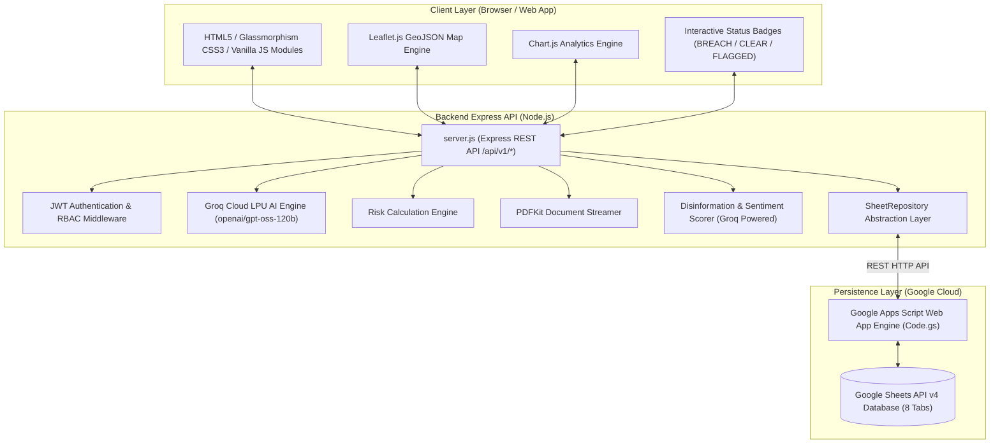

# 🛡️ PeaceKeeper AI — Complete System Specification & Application Details

> **Autonomous Treaty Compliance & Peacebuilding Swarm Platform**  
> *Production-Ready Multi-Source Intelligence & Threat Monitoring Suite*

---

## 1. 📌 Executive Overview & Core Architecture

**PeaceKeeper AI** is an advanced, autonomous conflict monitoring and treaty compliance verification platform designed for international diplomatic bodies, peacekeepers, defense analysts, and treaty compliance officers. 

The system continuously ingests multi-domain intelligence:
1. **OSINT Media & News Feeds** (Disinformation & Sentiment Analysis)
2. **Satellite Synthetic Aperture Radar (SAR) Imagery** (Military Hardware Bounding Boxes & DMZ Buffer Violations)
3. **Ground Incident Reports** (Tactical Field Evidence & Coordinates)
4. **International Treaty Compliance Matrix** (Violation Counts & Accord Expiries)

These data streams are synthesized by an **AI Multi-Factor Risk Calculation Engine** that produces an objective regional escalation score (0% to 100%), automatically triggers emergency broadcast alerts, updates interactive GIS GeoJSON maps, and streams PDF intelligence briefs.

---

## 2. 🏗️ System Architecture & High-Level Topology



### Data Synchronization & Caching Strategy
- **Primary Data Source**: Google Sheets API v4 accessed via Google Apps Script Web App (`Code.gs`).
- **Repository Pattern**: `SheetRepository.js` provides an abstraction over external Sheets calls.
- **In-Memory Fallback & Caching**: 60-second TTL caching reduces latency; seamless fallback to mock data repositories ensures continuous operation if the remote API experiences downtime.

---

## 3. 🧠 AI Multi-Factor Conflict Risk Engine

The platform calculates regional threat levels using a weighted multi-factor mathematical formula:

$$\text{Risk Score} = 0.30(R) + 0.25(S) + 0.15(N) + 0.15(E) + 0.15(T)$$

### Factor Breakdown:
| Parameter | Weight | Description | Computation Method |
|---|---|---|---|
| **$R$ (Ground Reports)** | **30%** | Ground Incident Frequency & Severity | Normalized report density in target region (capped at 10 reports = 100%). |
| **$S$ (Satellite SAR)** | **25%** | Satellite Military Hardware Detections | Bounding box detections (Tanks, Artillery, APCs +15% per DMZ breach). |
| **$N$ (Disinformation)** | **15%** | OSINT Fake News & Media Manipulation | Direct disinformation rating (0 = Credible, 100 = Manipulated / High Risk). |
| **$E$ (Social Sentiment)**| **15%** | Social & Media Sentiment Index | Inverse sentiment ratio mapped from $[-1, +1]$ to $[0, 100\%]$ negative impact. |
| **$T$ (Treaty Violations)**| **15%** | Logged Treaty Violation Counter | Normalized violation counts against active accords in the theater (capped at 30). |

### Escalation Thresholds & Automated Tactical Directives:
- **`0% - 25%` (Low Risk)**: Standard observation protocol active.
- **`26% - 50%` (Medium Risk / Elevated)**: Increase OSINT tracking; issue formal treaty compliance notice.
- **`51% - 75%` (High Risk / High Alert)**: Deploy peacekeeper monitoring teams; activate orbital SAR radar tracking.
- **`76% - 100%` (Critical / Emergency)**: Trigger automated emergency broadcast; mandate immediate UN Security Council dispatch.

---

## 4. 🗄️ Database Architecture (Google Sheets API v4 + `Code.gs`)

The application utilizes **Google Sheets** as a cloud database managed by a Google Apps Script deployment (`Code.gs`).

- **Apps Script Web App Endpoint**: `https://script.google.com/macros/s/AKfycbwncMQnlp8l1XfsmKYjB7-k-LmTPKeR7yi2hveySayWiVYCw6z3HLuO74IFPUXj4cY/exec`

### 8 Tab Schemas & Column Contracts:

```
1. users
   ├── id (String)
   ├── name (String)
   ├── email (String)
   ├── passwordHash (String - Bcrypt)
   ├── role (Admin / Observer)
   ├── avatarUrl (String)
   ├── notificationPrefs (JSON String)
   └── createdAt (ISO Timestamp)

2. reports
   ├── id (String)
   ├── reportedBy (String)
   ├── country (String)
   ├── state (String)
   ├── district (String)
   ├── lat (Float)
   ├── lng (Float)
   ├── conflictType (Troop Movement / Missile Launch / DMZ Breach / Artillery Fire)
   ├── description (Text)
   ├── evidenceImages (JSON Array URL)
   ├── videos (JSON Array URL)
   ├── documents (JSON Array URL)
   ├── status (Verified / Pending / Flagged)
   ├── riskLevel (Low / Medium / High / Critical)
   ├── riskPercentage (Number)
   └── createdAt (ISO Timestamp)

3. alerts
   ├── id (String)
   ├── level (Critical / High / Medium / Low)
   ├── title (String)
   ├── message (Text)
   ├── relatedReport (Report ID)
   ├── region (String)
   ├── emailSent (Boolean)
   ├── acknowledged (Boolean)
   └── createdAt (ISO Timestamp)

4. treaties
   ├── id (String)
   ├── name (String)
   ├── countries (Comma-Separated String)
   ├── startDate (ISO Date)
   ├── expiryDate (ISO Date)
   ├── status (ACTIVE / BREACHED / UNDER_REVIEW / EXPIRED)
   ├── violationCount (Integer)
   └── documentUrl (URL)

5. satellite_images
   ├── id (String)
   ├── imageUrl (URL)
   ├── region (String)
   ├── lat (Float)
   ├── lng (Float)
   ├── uploadedBy (User ID)
   ├── detectionStatus (PROCESSED / PENDING / CLEAR)
   ├── objectDetectionResult (JSON String: {tanks, artillery, apc})
   ├── bufferZoneFlag (Boolean)
   └── capturedAt (ISO Timestamp)

6. news
   ├── id (String)
   ├── title (String)
   ├── sourceUrl (URL)
   ├── content (Text)
   ├── submittedBy (User ID)
   ├── verified (Boolean)
   ├── fakeNewsScore (0-100)
   ├── sentimentScore (-1.0 to +1.0)
   ├── relatedRegion (String)
   └── createdAt (ISO Timestamp)

7. activities
   ├── id (String)
   ├── actorId (User ID)
   ├── action (String)
   ├── targetType (String)
   ├── targetId (String)
   ├── description (Text)
   └── timestamp (ISO Timestamp)

8. notifications
   ├── id (String)
   ├── userId (User ID)
   ├── type (ALERT / REPORT / TREATY / SYSTEM)
   ├── message (Text)
   ├── read (Boolean)
   ├── link (URL)
   └── createdAt (ISO Timestamp)
```

---

## 5. 💻 Frontend Web UI Architecture (11 Pages)

 built using **HTML5**, **Vanilla CSS3 (Glassmorphism design system)**, **Leaflet.js**, and **Chart.js**.

### Page Registry:
1. 🏠 **`index.html`** — Landing page introducing platform capabilities, live public threat indicators, and system metrics.
2. 🔑 **`login.html`** — User authentication portal with demo login toggles (`Admin` vs `Observer`).
3. 📊 **`dashboard.html`** — Main executive dashboard featuring real-time risk gauges, activity audit streams, active alerts, and incident quick-actions.
4. 🗺️ **`map.html`** — Tactical GIS Global Threat Map powered by Leaflet.js with custom GeoJSON polygon layers, hover tooltips, click intelligence modal, and PDF export trigger.
5. ⚠️ **`conflicts.html`** — Tactical Incident Logging & Reporting Hub with interactive status badges (`BREACH`, `CLEAR`, `YES (FLAGGED)`).
6. 🧮 **`risk.html`** — Interactive AI Multi-Factor Risk Calculation Engine Console with slider overrides and real-time score updates.
7. 🛰️ **`satellite.html`** — Synthetic Aperture Radar (SAR) Orbital Viewer with military hardware bounding box overlays and demilitarized buffer zone violation flags.
8. 📰 **`osint.html`** — Open Source Intelligence (OSINT) Media Feed & Fake News Scorer.
9. 📜 **`treaties.html`** — Non-Proliferation & Demilitarization Treaty Matrix with violation tracking and accord expiration meters.
10. 🚨 **`alerts.html`** — Emergency Alert Broadcast System with severity badges, tactical dispatch log, and notification toggles.
11. 📈 **`analytics.html`** — Multi-dimensional Chart.js visualizations (Monthly Conflict Escalation Trends, Risk Distribution Doughnut, Violation Counters per Country).
12. ⚙️ **`settings.html`** — System configuration center with interactive Role Switcher (`Admin` / `Observer`) and API connection diagnostics.
13. 📄 **`reports.html`** — Streaming PDF Report Generator & Archived Intelligence Brief Download Center.

---

## 6. 🔘 Interactive Badges & GIS Threat Map Mechanics

### Interactive Status Badges (`BREACH`, `CLEAR`, `YES (FLAGGED)`)
All status indicators across satellite viewer, tables, and map panels function as interactive modal triggers:
- **`BREACH` Badge**: Opens **DMZ Buffer Zone Breach Modal** presenting satellite synthetic aperture radar evidence, risk rating (Critical 92%), timestamp, and military breach coordinates.
- **`CLEAR` Badge**: Opens **Compliance Modal** showing zero-violation status, 24/7 orbital radar coverage confirmation, and 98.4% safety index score.
- **`YES (FLAGGED)` Badge**: Opens **Buffer Zone Violation Report** with 94.2% AI confidence score, 3km nuclear exclusion perimeter breach metrics, and UN Security Council recommended dispatches.

### GIS GeoJSON Interactive Map Layer (`map.html`)
- **GeoJSON Overlays**: Renders color-coded country polygons based on calculated conflict risk (Red = High/Critical Risk, Amber = Medium, Green = Low Risk).
- **Custom Tooltips**: Displays Country Name, Risk Percentage, Brief Summary, and Status Badges (`🔥 ACTIVE WAR / CONFLICT ZONE` or `🛡️ STABLE / LOW CONFLICT RISK`).
- **Country Intelligence Modal**: Clicking a country opens a full intelligence breakdown (Ground Reports, Satellite SAR Scans, Disinformation Score, Peacekeeper Recommendations).
- **Direct PDF Export**: Modal contains a button to stream an authenticated PDF intelligence brief for the selected country.

---

## 7. 🔌 Backend Architecture & REST API Reference

The backend is built on **Node.js** and **Express.js** (`/api/v1/*`).

### Complete Endpoint Registry:

| Category | Method | Endpoint | Access Level | Description |
|---|---|---|---|---|
| **Auth** | `POST` | `/api/v1/auth/login` | Public | Authenticates credentials and returns JWT bearer token. |
| **Auth** | `GET` | `/api/v1/auth/me` | Authenticated | Fetches current user profile and role details. |
| **Dashboard** | `GET` | `/api/v1/dashboard/summary` | Authenticated | Returns executive dashboard summary counters and metrics. |
| **Map** | `GET` | `/api/v1/map/countries-geojson` | Authenticated | Serves GeoJSON polygon feature collection with risk styling. |
| **Map** | `GET` | `/api/v1/map/country-analysis/:country` | Authenticated | Synthesizes real-time intelligence for country modal. |
| **Map / PDF**| `GET` | `/api/v1/map/country-analysis/:country/pdf` | Authenticated | Streams on-demand PDF intelligence report for a country. |
| **Reports** | `GET` | `/api/v1/reports` | Authenticated | Retrieves all incident reports with optional filtering. |
| **Reports** | `POST` | `/api/v1/reports` | Authenticated | Submits new ground incident report with evidence metadata. |
| **Reports/PDF**| `GET` | `/api/v1/reports/:id/download` | Authenticated | Streams single incident report as PDF document. |
| **Risk Engine**| `POST` | `/api/v1/risk/recalculate` | Authenticated | Triggers real-time AI risk recalculation for a region. |
| **News OSINT**| `GET` | `/api/v1/news` | Authenticated | Fetches ingested news stories and disinformation scores. |
| **News OSINT**| `POST` | `/api/v1/news` | Admin / User | Ingests new OSINT story and calculates fake news score. |
| **Satellite** | `GET` | `/api/v1/satellite` | Authenticated | Retrieves satellite SAR orbital captures and detection flags. |
| **Satellite** | `POST` | `/api/v1/satellite` | Admin Only | Uploads satellite image and triggers object detection. |
| **Treaties** | `GET` | `/api/v1/treaties` | Authenticated | Returns international treaty compliance matrix. |
| **Treaties** | `POST` | `/api/v1/treaties` | Admin Only | Creates new treaty record or updates violation counter. |
| **Alerts** | `GET` | `/api/v1/alerts` | Authenticated | Retrieves security alerts log and dispatch history. |
| **Alerts** | `POST` | `/api/v1/alerts` | Admin Only | Broadcasts emergency threat alert and emails peacekeepers. |
| **Analytics** | `GET` | `/api/v1/analytics/trends` | Authenticated | Supplies Chart.js formatted time-series & breakdown metrics. |
| **AI Engine** | `GET` | `/api/v1/ai/status` | Public | Reports Groq Cloud LPU AI status, active model, and availability. |
| **AI Engine** | `POST` | `/api/v1/ai/analyze` | Authenticated | Groq LLM disinformation analysis or geopolitical sentiment scoring. |
| **AI Engine** | `POST` | `/api/v1/ai/prompt` | Authenticated | Direct strategic intelligence prompts and conflict scenario simulations. |
| **System** | `GET` | `/api/v1/health` | Public | Returns server health status, uptime, and mode. |

---

## 8. 📄 Streaming PDF Intelligence Generator (`pdfGenerator.js`)

Built using **PDFKit**, the server dynamically builds and streams authenticated intelligence PDF briefs directly to the browser.

### PDF Features:
- **Header Banner**: Dark-themed security header with metadata (Classification Level: RESTRICTED // UN PEACEKEEPING DIVISION).
- **Executive Summary Box**: Color-coded risk status banner (Critical, High, Medium, Low).
- **Multi-Factor Breakdown Table**: Visual representation of $R, S, N, E, T$ scores.
- **Incident & Satellite Evidence Logs**: Embedded report lists, coordinates, and satellite detection bounding box flags.
- **Digital Verification Seal**: Auto-generated verification hash and timestamp.

---

## 9. 🔐 Security, Authentication & Role-Based Access Control (RBAC)

### Security Features:
- **Authentication**: JsonWebToken (`jwt.sign`/`jwt.verify`) with 24-hour token expiration.
- **Password Protection**: Bcrypt.js password hashing with salt rounds.
- **CORS & Payload Controls**: Explicit CORS domain policies and Express body parser size limits (25MB).
- **Role-Based Access Control (RBAC)**:
  - **`Admin`**: Full CRUD privileges, issue broadcast alerts, create treaties, verify OSINT news, upload satellite imagery.
  - **`Observer`**: Read-only dashboard access, view maps/analytics, submit ground incident reports.

### Demo User Accounts:
| Role | Email | Password | Permissions |
|---|---|---|---|
| **Admin** | `admin@peacekeeper.ai` | `password123` | Full System Access, Emergency Alerts, Admin Actions |
| **Observer** | `observer@peacekeeper.ai` | `password123` | Read-only Monitoring, Report Submission |

---

## 10. 📁 Complete Repository Directory Tree

```
PeaceKeeper-AI/
├── .env                              # Active Environment Variables
├── .env.example                      # Template Environment Variables
├── .gitignore                        # Git Exclusion Patterns
├── Code.gs                           # Google Apps Script Web App API Backend
├── README.md                         # Project Overview & Quick Start Documentation
├── FULL_APPLICATION_DETAILS.md       # Complete End-to-End Technical Specification
├── package.json                      # Node.js Dependencies & NPM Scripts
├── package-lock.json                 # Dependency Lockfile
├── vercel.json                       # Vercel Deployment & API Rewrite Config
├── client/                           # Frontend Single-Page App & Asset Suite
│   ├── index.html                    # Public Landing & Platform Showcase
│   ├── login.html                    # Authentication Portal
│   ├── dashboard.html                # Executive Command Center Dashboard
│   ├── map.html                      # GIS GeoJSON Interactive Threat Map
│   ├── conflicts.html                # Incident Reports & Conflict Zone Hub
│   ├── risk.html                     # AI Risk Calculation Engine Console
│   ├── satellite.html                # Satellite SAR Orbital Viewer
│   ├── osint.html                    # OSINT News Stream & Fake News Scorer
│   ├── treaties.html                 # Treaty Compliance Matrix
│   ├── alerts.html                   # Threat Alerts Broadcast System
│   ├── analytics.html                # Platform Analytics Suite
│   ├── settings.html                 # System Settings & Role Switcher
│   ├── reports.html                  # PDF Report Exporter & Brief Center
│   └── assets/                       # CSS Stylesheets, JS Modules, GeoJSON & Images
│       ├── css/
│       │   ├── style.css             # Core Glassmorphism Design System & Tokens
│       │   └── components.css        # Modal & Status Badge Component Styles
│       ├── js/
│       │   ├── main.js               # Global UI, Auth Manager & API Client
│       │   ├── map.js                # Leaflet.js Map Initialization & GeoJSON Engine
│       │   └── charts.js             # Chart.js Visualizations
│       └── data/
│           └── countries.geojson     # Global Polygon Geometry Feature Collection
└── server/                           # Backend Express REST API Server
    ├── server.js                     # Express App Entrypoint & Route Mounting
    ├── config/
    │   ├── env.js                    # Centralized Environment Variables
    │   └── db.js                     # Database Connection Orchestrator
    ├── middlewares/
    │   ├── authMiddleware.js         # JWT Token Verification Middleware
    │   ├── roleMiddleware.js         # RBAC Role Permission Enforcer
    │   └── errorHandler.js           # Global Error Handling Middleware
    ├── routes/
    │   ├── authRoutes.js             # Authentication Endpoints
    │   ├── dashboardRoutes.js        # Dashboard Summary Endpoints
    │   ├── mapRoutes.js              # GIS GeoJSON & Country Analysis Endpoints
    │   ├── conflictRoutes.js         # Conflict Incident Report Endpoints
    │   ├── riskRoutes.js             # Risk Recalculation Engine Endpoints
    │   ├── newsRoutes.js             # OSINT News Endpoints
    │   ├── satelliteRoutes.js        # Satellite SAR Image Endpoints
    │   ├── treatyRoutes.js           # Treaty Matrix Endpoints
    │   ├── alertRoutes.js            # Emergency Alert Endpoints
    │   ├── analyticsRoutes.js        # Chart Analytics Endpoints
    │   ├── notificationRoutes.js     # User Notification Endpoints
    │   └── reportExportRoutes.js     # PDF Generation & Streaming Endpoints
    ├── controllers/                  # Express Route Controller Handlers (12 Files)
    ├── services/
    │   ├── riskEngine.js             # Multi-Factor AI Risk Formula Implementation
    │   ├── countryAnalysisService.js # Country Intelligence Synthesizer
    │   ├── fakeNewsScorer.js         # Disinformation Scoring Algorithm
    │   ├── sentimentScorer.js        # Text Sentiment Analyzer
    │   └── pdfGenerator.js           # PDFKit Document Builder Engine
    ├── repositories/
    │   ├── SheetRepository.js        # Google Sheets API Abstraction & 60s TTL Cache
    │   ├── baseMockRepository.js     # Fallback In-Memory Storage Driver
    │   └── [entity]Repo.js           # Entity Repositories (Users, Reports, Alerts...)
    └── utils/
        └── logger.js                 # Centralized Logger Utility
```

---

## 11. ⚙️ Local Installation & Development Setup

### Prerequisites:
- **Node.js**: v18.0.0 or higher
- **NPM**: v9.0.0 or higher

### Step-by-Step Instructions:

1. **Clone the Repository**:
   ```bash
   git clone https://github.com/ksivakumarkalaiselvan/PeaceKeeper-AI.git
   cd PeaceKeeper-AI
   ```

2. **Install Node.js Dependencies**:
   ```bash
   npm install
   ```

3. **Configure Environment Variables**:
   Create a `.env` file in the root directory:
   ```env
   PORT=5000
   NODE_ENV=development
   JWT_SECRET=peacekeeper_super_secret_jwt_key_2026
   GOOGLE_APPS_SCRIPT_URL=https://script.google.com/macros/s/AKfycbwncMQnlp8l1XfsmKYjB7-k-LmTPKeR7yi2hveySayWiVYCw6z3HLuO74IFPUXj4cY/exec
   ```

4. **Launch the Local Development Server**:
   ```bash
   npm run dev
   # or
   node server/server.js
   ```

5. **Access the Web Dashboard**:
   Open browser at [`http://localhost:5000`](http://localhost:5000).

---

## 12. 🚀 Production Deployment Architecture

- **Backend REST API**: Deployed on **Render** (`https://peacekeeper-ai.onrender.com`).
- **Frontend & Static Hosting**: Deployed on **Vercel** with automatic route rewrites to Render backend via `vercel.json`:
  ```json
  {
    "rewrites": [
      {
        "source": "/api/v1/:path*",
        "destination": "https://peacekeeper-ai.onrender.com/api/v1/:path*"
      }
    ]
  }
  ```

---

*PeaceKeeper AI — Autonomous Treaty Compliance & Peacebuilding Swarm Platform*
